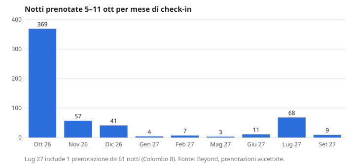

# Report settimanale portafoglio — settimana 5–11 ottobre 2026

Generato lunedì 12/10/2026. Fonte: Beyond (prenotazioni, performance). Valuta: EUR.

> **Consegna via email non attiva**: in questo ambiente non esiste uno strumento di invio mail. Il report viene salvato nel repository e segnalato con una notifica push.

## 1. Pick-up della scorsa settimana

Prenotazioni create tra il 5 e l'11 ottobre, stati "accepted", nessuna del proprietario.

| Fonte | Prenotazioni | Notti | Ricavo | ADR |
|---|---:|---:|---:|---:|
| Elenco prenotazioni (tutte) | 113 | 569 | 52.843 | 92,9 |
| Elenco prenotazioni (esclusa Colombo 8, 61 notti) | 112 | 508 | 34.209 | 67,3 |
| Aggregato Beyond (get_performance) | 99 | n.d. | 16.283 | 76 |

Le due fonti non coincidono: l'aggregato Beyond conta meno prenotazioni (99 contro 113) e non sono riuscito a stabilire il motivo. Il valore Beyond è la cifra ufficiale. Altre 14 prenotazioni fatte nella settimana risultano cancellate. Per canale (Beyond): Booking.com 70, Airbnb 29.

**Attenzione:** la prenotazione di Colombo 8 (check-in 01/07/2027, 61 notti, ADR 305) vale circa 18.600 € e da sola alza l'ADR da 67 a 93. Va verificata: potrebbe essere un errore di inserimento.

**Migliori per ADR**

| Listing | Check-in | Notti | ADR |
|---|---:|---:|---:|
| Colombo 8 | 01/07/2027 | 61 | 305 |
| Waterfront | 27/09/2027 | 9 | 276 |
| Praga 3 | 18/07/2027 | 7 | 230 |
| Roma Ariston | 03/01/2027 | 4 | 198 |
| Ciarli | 06/05/2027 | 3 | 155 |

**Peggiori per ADR**

| Listing | Check-in | Notti | ADR |
|---|---:|---:|---:|
| San Francesco 5 | 10/10/2026 | 7 | 33 |
| Brignole De Ferrari 4 | 14/12/2026 | 5 | 38 |
| Assereto | 11/10/2026 | 5 | 39 |
| Ferrari 135 | 01/11/2026 | 26 | 40 |
| Siffredi piccolo | 03/12/2026 | 13 | 41 |

San Francesco 5 era già tra i peggiori la settimana scorsa (ADR 31 e 36). Il prezzo minimo è 40 €, quindi queste prenotazioni sono entrate sotto il floor: probabilmente sconti di lunga permanenza o override da verificare.

## 2. Per quale periodo sono arrivate le prenotazioni

| Mese di check-in | Prenotazioni | Notti | ADR |
|---|---:|---:|---:|
| Ottobre 2026 | 88 | 369 | 58,6 |
| Novembre 2026 | 9 | 57 | 49,5 |
| Dicembre 2026 | 8 | 41 | 63,0 |
| 2027 (gen–set) | 8 | 102 | 198 (con Colombo 8; 94 senza) |

Per settimana di check-in (notti): 5–11 ott 85, **12–18 ott 137**, 19–25 ott 71, 26 ott–1 nov 72, poi meno di 15 a settimana. Il pick-up è molto concentrato sul brevissimo termine: il 78% delle prenotazioni riguarda soggiorni entro fine ottobre.

## 3. Andamento rispetto alla stessa settimana del 2025

| Metrica | 2026 | 2025 | Differenza |
|---|---:|---:|---:|
| Soggiorni 5–11 ott: occupazione | 76% | 68% | +8 pt |
| Soggiorni 5–11 ott: ADR | 70 | 73 | −4% |
| Soggiorni 5–11 ott: RevPAN | 53 | 50 | +7% |
| Soggiorni 5–11 ott: ricavo | 28.646 | 15.066 | +90% (*) |
| Pick-up 5–11 ott: ricavo | 16.283 | 15.515 | +5% |
| Pick-up 5–11 ott: ADR | 76 | 66 | +15% |
| Pick-up 5–11 ott: RevPAN | 96 | 86 | +12% |

(*) Il ricavo 2025 dei soggiorni sembra sottostimato rispetto all'occupazione (68% contro 76% non spiega +90%), quindi non va letto come crescita reale. L'occupazione e il RevPAN sono più affidabili.

Altri dati dei soggiorni della settimana: soggiorno medio 3,0 notti (mercato 2,1), min stay medio 2,99 (mercato 2,23), health score 69. Notti proprietario 4. Canali: Booking.com 53, Airbnb 37, Direct 6, Vrbo 2.

## 4. Appartamenti in ritardo nei prossimi 7 e 30 giorni

Occupazione calcolata sulle prenotazioni accettate (83 listing attivi mappati). Media portafoglio: **62,8% a 7 giorni** (12–18 ott), **32,2% a 30 giorni** (12 ott–10 nov). 6 listing hanno 0 notti vendute nei prossimi 7 giorni e 11 sono sotto il 10% a 30 giorni.

| Listing | Occ. 7 gg | Occ. 30 gg | Azione suggerita |
|---|---:|---:|---|
| Alta Via 1 | 0% | 0% | Base 56, min 34. Abbassare il prezzo del 10–15% sulle date vuote e togliere il min stay sulle prossime 2 settimane. |
| Baita del Plan | 0% | 0% | Mercato di montagna: verificare calendario e disponibilità sui canali e abbassare il minimo per i weekend. |
| Vittorio Veneto 10 (3 camere) | 0% | 0% | Base 150, tra i prezzi più alti: ridurre la base del 10–15% e attivare sconti last-minute. |
| Repetto 26 | 0% | 7% | Base 150: provare un ribasso del 15% sulle prossime 3 settimane. |
| Alta Via 4 | 0% | 13% | Come Alta Via 1: sconto last-minute e min stay a 1–2 notti. |
| Montanaro | 0% | 23% | Il 30 giorni è vicino alla media: agire solo sui prossimi 7 giorni con un ribasso mirato. |
| Boragine, Borgo Castello, Campana, Diaz 4F, Oleandri, Pirandello 5 | 14% | 3% | Prenotati solo 1 notte nei prossimi 30 giorni: ribasso del 10–15%, ridurre min stay, controllare le foto e il titolo. |
| Piccone 14 | 29% | 7% | Soggiorno fermo dopo la prima settimana: ribasso sulle date dal 19 ottobre. |

Azioni generali: (1) per le date entro 7 giorni usare uno sconto last-minute progressivo, rispettando i prezzi minimi; (2) ridurre il min stay a 1–2 notti sulle date vuote; (3) per i listing con 0% a 30 giorni controllare che il calendario sia sincronizzato e che non ci siano blocchi sui canali.

## 5. Sintesi e punti di attenzione

**Positivo**
- L'occupazione dei soggiorni della settimana (76%) è 8 punti sopra lo scorso anno, con RevPAN in crescita (+7%).
- L'ADR del pick-up (76) è del 15% superiore a quello dello stesso periodo 2025 e arrivano prenotazioni a lungo anticipo con ADR alto (Waterfront settembre 2027 a 276, Praga 3 luglio 2027 a 230, Roma Ariston gennaio 2027 a 198).
- Soggiorno medio di 3 notti, superiore alla media di mercato (2,1).

**Da attenzionare**
- ADR dei soggiorni leggermente sotto lo scorso anno (−4%): si sta riempiendo con prezzi più bassi.
- Pick-up quasi tutto last-minute: novembre e dicembre hanno pochissime notti nuove (57 e 41 in settimana) e occupazione a 30 giorni al 32%.
- San Francesco 5 vende regolarmente sotto il minimo (ADR 33): controllare regole di sconto e override.
- Prenotazione Colombo 8 da 61 notti a 305 € di ADR da verificare.
- 14 cancellazioni su prenotazioni fatte nella stessa settimana (11% sul totale).
- I numeri dell'elenco prenotazioni e dell'aggregato Beyond non coincidono (113 contro 99 prenotazioni).

## Note metodologiche

- Occupazione a 7/30 giorni calcolata da me sulle prenotazioni accettate, divisa per i giorni del periodo. Include le notti del proprietario. Dei 103 listing totali, 84 sono attivi; 83 compaiono nelle prenotazioni e i listing attivi senza canale mappato non sono nella media.
- Non ho interrogato get_pacing né i dati di mercato per singolo listing: i confronti con il 2025 vengono solo da get_performance.
