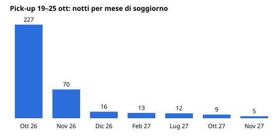

# Report settimanale portafoglio — settimana 19–25 ottobre 2026 (invio lunedì 26/10, ore 9)

Fonte: Beyond (valuta EUR). Pick-up = prenotazioni create 19–25/10, escluse cancellate e proprietari.

## 1. Pick-up della scorsa settimana
| | Prenotazioni | Notti | Ricavo | ADR |
|---|---:|---:|---:|---:|
| 19–25 ott | 79 | 352 | 21.946 | 62,3 |
| 12–18 ott | 59 | 245 | 22.665 | 92,5 |

Pick-up in crescita (+34% prenotazioni, +44% notti) ma ADR in calo del 33%: la settimana è trainata da soggiorni last-minute a prezzo basso.

**Migliori per ADR**
| Listing | Soggiorno | ADR |
|---|---|---:|
| Vittorio Veneto 50 | 26/07–02/08/2027 | 197 |
| Milano 22 | 19–24/07/2027 | 179 |
| Al Castello - Villa Anna Grande | 30/10–08/11/2026 | 122 |

**Peggiori per ADR**
| Listing | Soggiorno | ADR |
|---|---|---:|
| Alta Via 1 | 26/10–02/11/2026 | 35 |
| Alta Via 1 | 21/11–21/12/2026 (30 notti) | 37 |
| Gioiello | 25–26/10/2026 | 40 |

## 2. Periodo di soggiorno delle prenotazioni

Ottobre 227 notti (64%), novembre 70, dicembre 16; il resto sono 39 notti nel 2027 (feb, lug, ott, nov). Il pick-up è quasi tutto a brevissimo preavviso.

## 3. Andamento vs stesso periodo 2025 (stay date, 19–25 ott)
| | 2026 | 2025 | Δ |
|---|---:|---:|---:|
| Ricavo | 24.003 | 15.353 | +56% |
| Occupazione | 66% | 74% | −8 pt (−10%) |
| ADR | 66 | 63 | +3% |
| RevPAN | 44 | 47 | −7% |

Canali (prenotazioni): Booking.com 54, Airbnb 35, Direct 9. Soggiorno medio 3,0 notti.

Prossimi periodi (on-the-books, vs stesso momento 2025): 26/10–01/11 occupazione 46% (−6%), ADR 67, ricavo on-the-books 17.136 (occupazione finale 2025 della stessa settimana: 64%); 26/10–24/11 occupazione 23% vs 20% un anno fa alla stessa data (+13%), ADR 65 (−9%).

## 4. Appartamenti più indietro (occupazione prossimi 7 e 30 giorni)
Portafoglio: 46% a 7 giorni, 23% a 30 giorni. Calcolo per appartamento da prenotazioni accettate; non tiene conto di blocchi calendario.

- **0% sia a 7 che a 30 giorni:** Montanaro, Vittorio Veneto 10, Baita del Plan, XII Ottobre A, XII Ottobre B, Quota 3, Milano 22, Al Castello - Villa Anna Piccolo.
- **0% a 7 giorni:** anche San Francesco 5 (7% a 30 gg), Repetto 26, Strette.
- **Molto bassi a 30 giorni (≤7%):** Quota 6, Siffredi piccolo, Piccone 4, San Francesco 5.

Azioni suggerite:
1. Verificare blocchi, override e minimi di soggiorno su quelli a 0%; sono la prima causa di calendario vuoto.
2. Ridurre il minimo di soggiorno a 1–2 notti nei 7 giorni (domanda last-minute prevalente) e controllare il prezzo minimo.
3. Per San Francesco 5 (già tra i peggiori ADR a settembre) rivedere base e prezzo minimo.
4. Per Baita del Plan, Quota 3/6, le ville e Milano 22 verificare se la chiusura è stagionale; in caso contrario valutare sconti per soggiorni lunghi.
Nota: 19 listing non hanno prenotazioni future e non compaiono nell'elenco; vanno verificati a parte.

## 5. In breve
**Da attenzionare:** ADR del pick-up crollato (62 vs 92) e occupazione −8 pt sulla settimana appena chiusa; le prenotazioni a 30 giorni sono deboli (23%) con ADR −9% rispetto a un anno fa; Alta Via 1 con soggiorni da 35–37 €/notte, incluso un mensile a 37.
**Positivo:** ricavo +56% e ADR +3% sulla settimana vs 2025; domanda forte a lungo anticipo per estate 2027 (Vittorio Veneto 50 a 197, Milano 22 a 179); prenotazioni 30 giorni in recupero di occupazione (+13% vs un anno fa).
